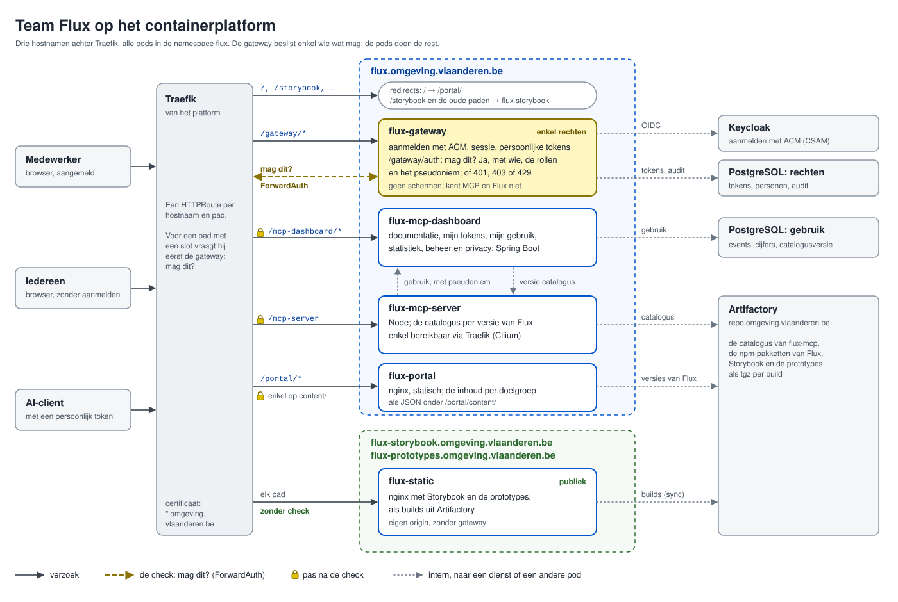

# De opzet op het platform

Wat Team Flux online heeft, staat nu op vier plaatsen:

- **Storybook** op GitHub Pages, vanuit de repo flux-builds, onder `flux.omgeving.vlaanderen.be`;
- **de prototypes** op GitHub Pages, vanuit flux-prototypes, onder `flux-prototypes.omgeving.vlaanderen.be`;
- **dit portaal** op GitHub Pages, onder `milieuinfo.github.io/flux`;
- **Flux-MCP** op het containerplatform: de MCP-server en de gateway (`flux-mcp-server` en `flux-mcp-gateway`), uit
  flux-mcp, in de namespace `flux-mcp`, met de configuratie in flux-mcp-config.

Deze afweging zet alles op het platform, achter één gateway die enkel de rechten regelt.

## Wat de opzet bepaalt

1. **Het platform.** Traefik routeert met de Gateway API (een HTTPRoute op `traefik-gateway`), Cilium bepaalt welk
   verkeer tussen pods mag, een `KeycloakClient` regelt het aanmelden, en Argo CD rolt uit wat in KCL beschreven staat.
   Traefik kent ForwardAuth; of een team het zelf mag instellen, is de belangrijkste open vraag.
2. **De gateway van nu (`flux-mcp-gateway`) doet acht dingen** (`docs/technisch/gateway.md` in flux-mcp). Twee zijn
   rechten: aanmelden en het token controleren. De rest hoort bij Flux-MCP: de documentatie, Mijn tokens en Mijn
   gebruik, de statistiek, het beheer, de privacypagina, het gebruik bewaren en de versie van de catalogus.
3. **Het bewaren van het gebruik steunt nu op de gateway als proxy.** Hij ziet wie het vraagt, en in de header
   `X-Flux-Mcp-Usage` van het antwoord wat de server deed. Met ForwardAuth ziet de gateway het antwoord niet meer.
4. **Storybook staat op de hostnaam die het portaal krijgt.** De catalogus van flux-mcp linkt er 8.454 keer naar: 6.877
   keer naar `/release-v2`, 1.569 keer naar `/release-v1` en 8 keer naar `/release`.

## De hostnamen en de paden

| Hostnaam                                 | Pad                                                                | Naar                     | Aanmelden                                       |
| ---------------------------------------- | ------------------------------------------------------------------ | ------------------------ | ----------------------------------------------- |
| `flux.omgeving.vlaanderen.be`            | `/`                                                                | redirect naar `/portal/` | nee                                             |
|                                          | `/portal/`                                                         | `flux-portal`            | nee, behalve de inhoud onder `/portal/content/` |
|                                          | `/mcp-server`                                                      | `flux-mcp-server`        | ja, met een persoonlijk token                   |
|                                          | `/mcp-dashboard/`                                                  | `flux-mcp-dashboard`     | ja, behalve de privacypagina                    |
|                                          | `/gateway/`                                                        | `flux-gateway`           | dit is het aanmelden                            |
|                                          | `/storybook`, `/release-v1`, `/release-v2`, `/release`, `/develop` | redirect naar Storybook  | nee                                             |
| `flux-storybook.omgeving.vlaanderen.be`  | alles                                                              | `flux-static`            | nee                                             |
| `flux-prototypes.omgeving.vlaanderen.be` | alles                                                              | `flux-static`            | nee                                             |

Alle pods staan in de namespace `flux`. Waarom drie hostnamen, en niet alles onder `flux.omgeving.vlaanderen.be`:
[De hostnamen](02-hostnamen.md); waarom deze namen en paden: [De namen](06-namen.md).

## Hoe een verzoek loopt

1. Traefik ontvangt het verzoek en zoekt de HTTPRoute voor de hostnaam en het pad.
2. Is het pad afgeschermd, dan vraagt Traefik eerst aan `/gateway/auth` of het mag. Hij geeft de cookie of het token
   van het verzoek mee.
3. De gateway antwoordt:
    - **200** met headers, bijvoorbeeld wie je bent (`X-Flux-User`), je rollen (`X-Flux-Roles`) en je pseudoniem
      (`X-Flux-Pseudonym`). Traefik zet ze op het verzoek en stuurt het door;
    - **401** als je niet aangemeld bent: voor een pagina een redirect naar `/gateway/login`, voor JSON enkel de 401;
    - **403** als je aangemeld bent, maar de rol niet hebt;
    - **429** als je boven je grens zit.
4. De pod vertrouwt de headers, om twee redenen: enkel Traefik bereikt hem (Cilium), en Traefik overschrijft headers
   met die namen die een client zelf meestuurt (`authResponseHeaders`).

Een publiek pad, zoals de app van het portaal of Storybook, stuurt Traefik meteen door. De check staat enkel op wat
afgeschermd is: elke vraag aan de gateway kost tijd, en de bestanden van een app zeggen zonder hun inhoud niets.

## De pods

### flux-gateway

De gateway regelt enkel de rechten:

- **aanmelden en afmelden:** `/gateway/login?rd=…`, `/gateway/callback` en `/gateway/logout`, met de bestaande
  `KeycloakClient`, hernoemd naar `flux-gateway`, en de aansluiting "Digitalisering intern" van ACM;
- **`/gateway/auth`:** het antwoord voor Traefik, met de sessiecookie van een browser of het persoonlijke token van
  een AI-client (ADR-009 in flux-mcp);
- **`/gateway/me`:** wie je bent en je rollen, voor het portaal en het mcp-dashboard;
- **`/gateway/api/`:** tokens maken, tonen en intrekken, met hun team; personen blokkeren; beheerders aanduiden. De
  schermen daarvoor staan in het mcp-dashboard;
- **de regels:** welk pad welke rol vraagt, in een ConfigMap in flux-config. Alles is dicht, tenzij een regel het
  opent. Een recht wijzigen is een merge request, zonder nieuwe image;
- **het auditrecord:** wie, wanneer en met welk token, voor `/mcp-server`, in een schema waarin de toepassing enkel
  schrijft
  (ADR-011 in flux-mcp);
- **het pseudoniem:** de gateway berekent het met een sleutel die enkel hij kent. Zet je de koppeling uit, dan geeft
  hij er geen mee.

Geen schermen, geen statistiek, en geen kennis van MCP of Flux. Zijn databank bevat de tokens (als hash), de personen
met hun team, en het auditrecord.

### flux-portal

- **Het portaal is nginx** met de build onder `/portal/`. Een onbekend pad krijgt `index.html`; `pages.json` en
  `404.html`, nodig voor GitHub Pages, vallen weg.
- **De inhoud per doelgroep,** als JSON onder `/portal/content/`: bijvoorbeeld `public.json`, `authenticated.json` en
  `team.json`. De gateway beslist per bestand wie het krijgt. Het portaal vraagt ze allemaal, en slaat een 401 of 403
  over. Wat je niet mag zien, zit niet in de bundel en komt nooit in je browser.
- **Aanmelden:** zegt `/gateway/me` dat je niet aangemeld bent, dan toont het portaal de knop om aan te melden.
- **De nieuwste release van Flux** komt uit Artifactory, via nginx, dat het antwoord een uur bewaart. Nu vraagt elke
  browser het aan de API van GitHub, die zonder aanmelden 60 verzoeken per uur per IP-adres toelaat. Achter de NAT van
  het departement delen veel medewerkers één adres. Artifactory rechtstreeks vanuit de browser gaat niet: het stuurt
  geen CORS-headers.

### flux-mcp-server

- **De MCP-server is enkel bereikbaar via `/mcp-server`,** na de check. Cilium laat enkel Traefik toe, en het
  mcp-dashboard voor de wissel van de catalogus.
- **Het gedeelde geheim** (`X-Flux-Mcp-Secret`) blijft enkel tussen het mcp-dashboard en de server, voor `/beheer/`.
  Voor `/mcp-server` is het netwerkbeleid het slot.
- **Het gebruik:** per verzoek stuurt de server een event naar het mcp-dashboard, intern, met het pseudoniem uit de
  header en wat nu in `X-Flux-Mcp-Usage` staat. Hij kent zo het pseudoniem, niet de persoon.

### flux-mcp-dashboard

- **Het mcp-dashboard is wat nu de app van de gateway is, zonder de rechten:** de startpagina en de documentatie, Mijn
  tokens (op de API van de gateway), Mijn gebruik, de statistiek met de berekening op maandag, het beheer van de
  catalogus en de privacypagina.
- **Spring Boot met de app in Flux,** met een eigen databank: de events, de cijfers per week, de zoekvragen zonder
  treffers en de versie van de catalogus (ADR-008 in flux-mcp).
- Het grootste deel van de code komt uit de huidige gateway.

### flux-static

De statische pod: nginx met Storybook en de prototypes, elk op zijn eigen hostnaam: [Storybook en de
prototypes](03-storybook-en-prototypes.md).

## Het gebruik en de privacy

De opzet scheidt beter wat ADR-011 wil scheiden:

|                                           | Nu                                                  | Voorstel                                    |
| ----------------------------------------- | --------------------------------------------------- | ------------------------------------------- |
| Wie het vroeg (het auditrecord)           | de gateway                                          | de gateway, bij de check                    |
| Wat het vroeg, met een pseudoniem (event) | de gateway, met wat de server in de header meegeeft | het mcp-dashboard, met wat de server stuurt |
| De sleutel van het pseudoniem             | de gateway                                          | de gateway                                  |

De gateway ziet niet meer wat iemand vroeg, en het mcp-dashboard niet wie. Toch is het een andere verwerking: de
beschrijving bij de DPIA en het akkoord van de DPO en de SISO moeten opnieuw.

## Eén hostnaam, één origin

Het portaal, het mcp-dashboard en de gateway delen een origin. Een script op een van hen kan, namens een aangemelde
bezoeker, de API van de gateway aanroepen en het antwoord lezen. Daarom:

- **de sessiecookie** is `HttpOnly`, `Secure` en `SameSite=Lax`, zonder `Domain`: de browser stuurt ze niet naar
  `flux-storybook` of `flux-prototypes`;
- **`/gateway/api/`** is beschermd tegen CSRF;
- **elke app** krijgt een strikte CSP (zie flux-csp-poc);
- **Storybook en de prototypes** krijgen een eigen hostnaam: ze dragen het meeste JavaScript, ook oud dat niemand nog
  bijwerkt ([De hostnamen](02-hostnamen.md)).

## Alternatieven

### De gateway

|                         | Eigen code (voorstel)                            | oauth2-proxy                                                     | De gateway als proxy voor alles                               |
| ----------------------- | ------------------------------------------------ | ---------------------------------------------------------------- | ------------------------------------------------------------- |
| **Wat**                 | de huidige gateway, teruggebracht tot de rechten | een bestaand product voor aanmelden met OIDC, met ForwardAuth    | alles loopt door de gateway, die beslist en doorstuurt        |
| **Persoonlijke tokens** | blijven                                          | vallen weg: een AI-client moet zelf een token van Keycloak halen | blijven                                                       |
| **Eigen code**          | aanmelden, tokens en regels                      | geen, enkel configuratie                                         | aanmelden, tokens, regels en het doorsturen                   |
| **Wanneer**             | als een team ForwardAuth mag instellen           | als de persoonlijke tokens mogen wegvallen                       | als ForwardAuth niet mag                                      |
| **Nadeel**              | eigen code om te onderhouden                     | Keycloak is van het platform; een client per AI-client gaat niet | al het verkeer, ook dat van het portaal, hangt aan de gateway |

### Eén frontend

Het portaal volgt al de layout van de app van de gateway. De pagina's van het mcp-dashboard kunnen dus ook routes in
het portaal worden (`/portal/mcp/…`), met het mcp-dashboard als enkel een API. Dat geeft één menu en één look, en een
menu dat groeit met je rechten. Maar het portaal hangt dan aan de releases van flux-mcp: een nieuwe pagina in het
mcp-dashboard vraagt een release van beide. Het voorstel houdt twee apps, met dezelfde layout.

## De overgang

1. **De code naar GitLab,** met de spiegel voor flux-web-components ([05](05-gitlab-met-spiegel.md)). Het portaal leest
   de nieuwste release dan van de tags.
2. **De gateway uit flux-mcp halen,** als `flux-gateway` in een eigen repo, en ForwardAuth invoeren, eerst op `oe`, op
   de huidige hostnaam `flux-mcp-oefen.omgeving.vlaanderen.be`. Wat overblijft, wordt het mcp-dashboard.
3. **De pod voor Storybook en de prototypes,** eerst op `oe`, dan `flux-storybook.omgeving.vlaanderen.be`, dan de DNS
   van `flux-prototypes.omgeving.vlaanderen.be` van GitHub Pages naar het platform
   ([03](03-storybook-en-prototypes.md)). Tot stap 5 krijgt flux-builds elke release nog mee.
4. **Het portaal als pod,** op `flux-oefen.omgeving.vlaanderen.be/portal/`, en alles in de namespace `flux`.
5. **De DNS van `flux.omgeving.vlaanderen.be`** van GitHub Pages naar het platform, met de redirects voor de oude paden
   van Storybook. flux-builds en de GitHub Pages van het portaal stoppen. Vanaf nu kan Flux-MCP naar `pr`, op
   `flux.omgeving.vlaanderen.be/mcp-server`: een eigen hostnaam `flux-mcp` komt er niet ([06](06-namen.md)).
6. **De catalogus van flux-mcp opnieuw,** met de nieuwe links naar Storybook, zonder uitrol (ADR-008). De hostnamen
   `flux-mcp-ontwikkel` en `flux-mcp-oefen` sturen hun `/mcp` nog een tijd naar de MCP-server, zonder redirect: een
   AI-client volgt een redirect bij een POST niet altijd, en zijn configuratie wijst naar die naam.

## Conclusie

Vijf soorten pods achter Traefik, in de namespace `flux`: `flux-gateway`, die enkel de rechten regelt, `flux-portal`,
`flux-mcp-server`, `flux-mcp-dashboard`, en `flux-static` voor Storybook en de prototypes. Traefik vraagt de gateway
bij elk afgeschermd verzoek of het mag; de pods krijgen het antwoord in headers. Wat je in het portaal ziet, hangt af
van de bestanden die de gateway je geeft. De pagina's die nu in de gateway zitten, worden het mcp-dashboard, en het
bewaren van het gebruik verhuist mee, met een nieuwe DPIA.

Welke hostnamen dat krijgt, is de volgende afweging: [De hostnamen](02-hostnamen.md).

## Zie ook

- In flux-mcp: `docs/technisch/gateway.md` (wat de gateway nu doet), `docs/technisch/platform.md` (de pijplijn, de
  configuratie en het aanmelden), ADR-007 tot ADR-011, en de afweging `docs/afwegingen/03-met-of-zonder-gateway.md`.
  ADR-007 plande de hostnaam `flux-mcp.omgeving.vlaanderen.be` voor `pr`; [De namen](06-namen.md) vervangt die.

## Bronnen

- [Traefik: ForwardAuth](https://doc.traefik.io/traefik/middlewares/http/forwardauth/)
- [Traefik: de Gateway API](https://doc.traefik.io/traefik/routing/providers/kubernetes-gateway/)
- [oauth2-proxy](https://oauth2-proxy.github.io/oauth2-proxy/)
- [GitHub: de grenzen van de REST API](https://docs.github.com/en/rest/using-the-rest-api/rate-limits-for-the-rest-api)
