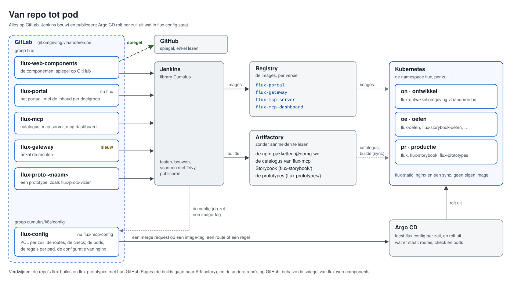

# De repo's

De opzet heeft vijf soorten pods ([01](01-opzet-op-het-platform.md)), en alles komt op GitLab
([05](05-gitlab-met-spiegel.md)). Welke repo's zijn dan zinvol: één monorepo, één repo per pod, of iets ertussen?

## Wat de keuze bepaalt

- **De pijplijn van het platform kent één image per repo.** De library `Cumulus` en haar config-job gaan uit van één
  image. flux-mcp bouwt er twee, met een eigen Jenkinsfile en de parameter `ONDERDEEL`; het kan, maar het is een omweg.
- **De build van flux-mcp is zwaar:** Jest, Cypress, en Maven met Testcontainers. Dat wil je niet voor een link in het
  portaal.
- **Een publiek project kan niet op GitLab.** Wat publiek moet, komt via een spiegel op GitHub
  ([05](05-gitlab-met-spiegel.md)); een repo is dus helemaal intern, of helemaal gespiegeld.
- **Argo CD leest de configuratie uit een eigen repo,** zoals nu flux-mcp-config. Jenkins schrijft daar enkel een
  image-tag.

## Voorstel

Splitsen volgens ritme, eigenaar en of iets publiek mag, niet per pod; de configuratie apart.

| Repo                                 | Inhoud                                                                                   | Wat de pijplijn maakt                                                               | Spiegel op GitHub |
| ------------------------------------ | ---------------------------------------------------------------------------------------- | ----------------------------------------------------------------------------------- | ----------------- |
| **flux-web-components**              | de componenten                                                                           | de npm-pakketten `@domg-wc` en Storybook als tgz, op Artifactory                    | ja, enkel lezen   |
| **flux-portal** (nu flux)            | het portaal, met de inhoud per doelgroep                                                 | de image `flux-portal`                                                              | nee               |
| **flux-mcp**                         | de catalogus, de MCP-server en het mcp-dashboard                                         | de images `flux-mcp-server` en `flux-mcp-dashboard`, en het pakket van de catalogus | nee               |
| **flux-gateway** (nieuw)             | de gateway                                                                               | de image `flux-gateway` (nu `flux-mcp-gateway`, uit flux-mcp)                       | nee               |
| **flux-config** (nu flux-mcp-config) | KCL per zuil: de routes, de check, de pods, de regels per pad, de configuratie van nginx | niets; Argo CD rolt het uit                                                         | nee               |

Op GitLab staan ze in de groep `flux`, waar flux-mcp en flux-csp-poc al staan; flux-config staat in
`cumulus/k8s/config`, zoals nu flux-mcp-config. Waarom deze namen: [De namen](06-namen.md).

Daarnaast, zonder pod van zichzelf:

- **de prototypes,** elk in `flux-proto-<naam>`, zoals flux-proto-vizier: hun build gaat als tgz naar Artifactory
  ([03](03-storybook-en-prototypes.md));
- **flux-agents** en **flux-starter-app,** zoals nu;
- **flux-assets:** publiek op GitHub. Gebruikt iemand buiten het departement het, dan krijgt het dezelfde spiegel als
  flux-web-components.

Wat wegvalt: flux-builds en flux-prototypes, met hun GitHub Pages. Ze worden gearchiveerd op GitHub.

## Waarom zo

- **flux-gateway apart.** De gateway is gevoelig voor de veiligheid, verandert traag, en verdient een eigen review en
  scan. Hij kent Flux niet, en kan dus ook voor iets anders dienen.
- **De MCP-server en het mcp-dashboard samen in flux-mcp.** Ze delen het formaat van een event en de versie van de
  catalogus, en veranderen samen. De pijplijn bouwt al twee images.
- **Het portaal apart.** Het verandert het vaakst, met de kleinste build. Zijn inhoud voor een doelgroep mag in de repo,
  want die is intern.
- **De regels per pad in flux-config,** niet in de gateway. Wie wat mag, staat zo naast de routes die bepalen welke
  paden er zijn. Een recht wijzigen is een merge request, zonder nieuwe image.
- **Eén config-repo voor alle hostnamen.** De drie hostnamen delen Traefik, de check en de `KeycloakClient`; Argo CD
  rolt per zuil één geheel uit.

## Alternatieven

|                                        | Eén monorepo                                            | Een repo per pod                | Het voorstel                           |
| -------------------------------------- | ------------------------------------------------------- | ------------------------------- | -------------------------------------- |
| **Een wijziging over onderdelen heen** | één merge request                                       | een merge request per repo      | één, behalve tussen gateway en de rest |
| **De build**                           | alles bij elke wijziging, of een pijplijn die kiest wat | klein per repo                  | klein, behalve flux-mcp                |
| **De pijplijn**                        | vier images in één repo: een grote omweg rond `Cumulus` | zoals het platform het verwacht | één omweg: flux-mcp, die er al is      |
| **Publiek en intern**                  | gaat niet samen: één spiegel spiegelt alles             | per repo                        | per repo                               |
| **Releases**                           | één ritme voor alles, of tags per onderdeel             | een ritme per pod               | een ritme per eigenaar                 |

Een monorepo valt af: de pijplijn kent één image per repo, de build van flux-mcp loopt dan ook bij een link in het
portaal, en de componenten moeten gespiegeld worden, de rest niet. Een repo per pod valt af voor de MCP-server en het
mcp-dashboard: ze veranderen samen, en elke wijziging werd dan twee merge requests.

## Conclusie

Vijf repo's: flux-web-components, flux-portal, flux-mcp, flux-gateway en flux-config. Alleen flux-web-components krijgt
een spiegel op GitHub; Storybook en de prototypes komen via Artifactory, zonder eigen repo voor hun pod.

Wat de overstap naar GitLab vraagt, is de volgende afweging:
[GitLab, met een spiegel op GitHub](05-gitlab-met-spiegel.md).
