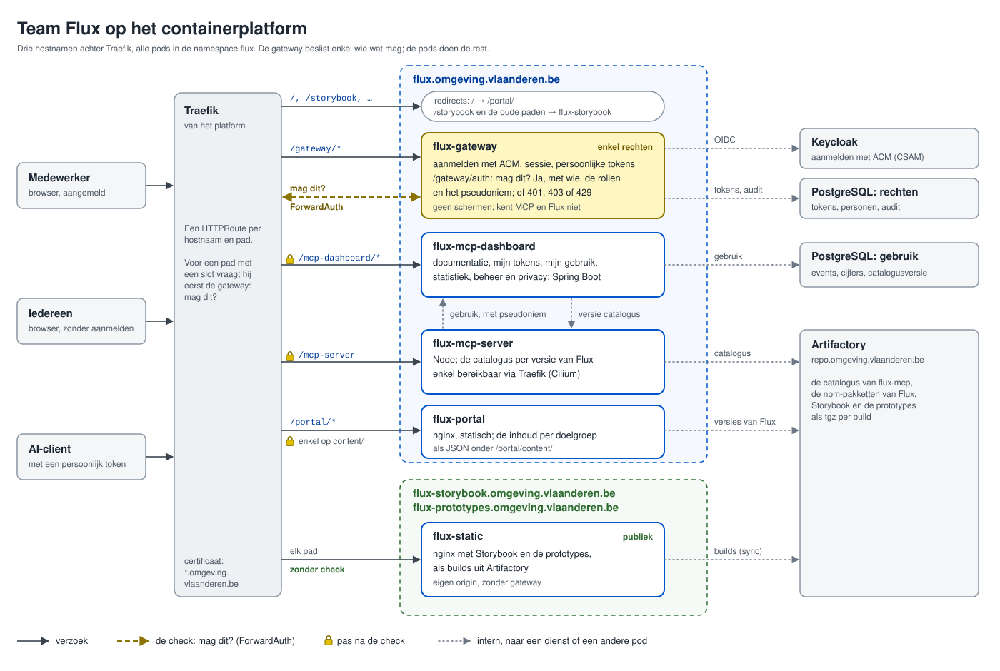

# De architectuur van Team Flux

Team Flux maakt de web componenten met hun documentatie in Storybook, Flux-MCP met zijn gateway, prototypes en dit
portaal. Ze staan nu verspreid over GitHub, GitHub Pages, GitLab en het containerplatform van het departement. Deze map
bedenkt de opzet opnieuw, alsof er nog niets is:

- `https://flux.omgeving.vlaanderen.be/` stuurt door naar het portaal onder `/portal`;
- onder `/portal` het portaal, onder `/mcp-server` de MCP-server, onder `/mcp-dashboard` de documentatie en de
  pagina's die nu in de gateway zitten, en onder `/gateway` het aanmelden;
- afhankelijk van je rechten zie je in het portaal meer of minder;
- alles draait als pods, en de gateway regelt enkel de rechten.

**Stand op 10 november 2026.** Beslist zijn de hostnamen ([02](02-hostnamen.md)), GitLab met een spiegel op GitHub
voor flux-web-components ([05](05-gitlab-met-spiegel.md)), en de namen en de paden ([06](06-namen.md)). De rest is een
voorstel, met de open vragen onderaan.

Elke afweging eindigt met een conclusie waarop de volgende verder bouwt; lees ze dus in volgorde.

| Afweging                                                      | De vraag                                                        |
| ------------------------------------------------------------- | --------------------------------------------------------------- |
| [De opzet op het platform](01-opzet-op-het-platform.md)       | welke pods er zijn, en hoe de gateway beslist wie wat ziet      |
| [De hostnamen](02-hostnamen.md)                               | waarom drie hostnamen, elk op één niveau onder het departement  |
| [Storybook en de prototypes](03-storybook-en-prototypes.md)   | hoe 3,7 GB aan builds publiek op het platform komt              |
| [De repo's](04-repos.md)                                      | welke repo's, en waarom geen monorepo                           |
| [GitLab, met een spiegel op GitHub](05-gitlab-met-spiegel.md) | wat er verandert als de code van GitHub naar GitLab gaat        |
| [De namen](06-namen.md)                                       | hoe elk onderdeel heet, in de repo, de image, de pod en het pad |

## Begrippen

- **Flux:** het designsysteem van het departement: de web componenten (`@domg-wc`), hun documentatie in Storybook en
  het ontwerp in Figma. Niet het portaal, en niet de hostnaam.
- **Team Flux:** het team dat Flux maakt, en alles in deze map.
- **Flux-AI:** de aanpak om frontends met AI naar Flux te stroomlijnen, met een gids in Storybook.
- **Flux-MCP:** het gereedschap daarvoor: de MCP-server, het mcp-dashboard en de catalogus, uit de repo flux-mcp.
- **De gateway:** in deze map enkel wat over de rechten beslist (`flux-gateway`). Wat nu in flux-mcp "de gateway" heet,
  met de tokens en de documentatie, wordt grotendeels het mcp-dashboard.
- **Pod:** één draaiende instantie van een container. Een Deployment houdt er een aantal draaiende, en vervangt ze bij
  een nieuwe versie.
- **Zuil:** een omgeving van het platform: `on` (ontwikkel), `oe` (oefen) en `pr` (productie).
- **Traefik:** de router van het platform. Hij ontvangt elk verzoek en stuurt het per hostnaam en pad naar een pod,
  volgens een HTTPRoute.
- **ForwardAuth:** Traefik vraagt bij een verzoek eerst aan een andere dienst of het mag, en stuurt het enkel bij een
  ja door.
- **Origin:** het protocol en de hostnaam van een pagina. Scripts van dezelfde origin lezen elkaars gegevens, en roepen
  elkaars API aan met de cookies van de bezoeker.
- **Spiegel:** een kopie van een repo die automatisch volgt, en waarin niemand rechtstreeks werkt.

## De opzet in het kort

- **Drie hostnamen:** `flux.omgeving.vlaanderen.be` voor het portaal, de MCP-server, het mcp-dashboard en de gateway;
  `flux-storybook` en `flux-prototypes` publiek, elk met een eigen origin ([01](01-opzet-op-het-platform.md),
  [02](02-hostnamen.md)).
- **De gateway regelt enkel de rechten:** Traefik vraagt hem bij elk afgeschermd verzoek of het mag. De pagina's die nu
  in de gateway zitten, worden het mcp-dashboard ([01](01-opzet-op-het-platform.md)).
- **Storybook en de prototypes** komen als builds uit Artifactory in één pod met nginx, zonder eigen image
  ([03](03-storybook-en-prototypes.md)).
- **Vijf repo's:** flux-web-components, flux-portal, flux-mcp, flux-gateway en flux-config, gesplitst volgens ritme en
  eigenaar, niet per pod ([04](04-repos.md)).
- **Alles op GitLab;** flux-web-components krijgt een spiegel op GitHub die enkel gelezen wordt
  ([05](05-gitlab-met-spiegel.md)).
- **Eén naam per onderdeel:** `flux-<onderdeel>` in de repo, de image en de pod, en als pad die naam zonder `flux-`:
  `/portal`, `/gateway`, `/mcp-server` en `/mcp-dashboard`. Alle pods staan in de namespace `flux`
  ([06](06-namen.md)).

## Open vragen

Voor het platformteam:

1. Mag een team ForwardAuth instellen: een `Middleware` van Traefik, vanuit een HTTPRoute? Zo niet, dan wordt de
   gateway een proxy voor alles ([01](01-opzet-op-het-platform.md#alternatieven)).
2. Is er al een gedeelde oplossing om aan te melden, zodat de gateway minder eigen code nodig heeft?
3. Wie zet de bestaande DNS-records van `flux` en `flux-prototypes` om, van GitHub Pages naar het platform
   ([02](02-hostnamen.md))?
4. Hoeveel tijdelijke schijf mag een pod gebruiken? Storybook vraagt zo'n 3 GB per pod
   ([03](03-storybook-en-prototypes.md)).
5. Mag GitLab naar github.com verbinden, voor de spiegel ([05](05-gitlab-met-spiegel.md))?
6. Kan een project op GitLab een eigen token krijgen (een project access token), zodat een release niet aan een persoon
   hangt ([05](05-gitlab-met-spiegel.md))?
7. Kunnen de namespace `flux` en de config-repo `flux-config` de namen uit HLPD-83052 vervangen (`flux-mcp` en
   `flux-mcp-config`), en de Keycloak-client `flux-gateway` die van `flux-mcp-gateway` ([06](06-namen.md))?

Voor de DPO en de SISO:

8. Het gebruik van Flux-MCP wordt voortaan bewaard door de MCP-server en het mcp-dashboard, niet meer door de gateway.
   De beschrijving bij de DPIA moet mee ([01](01-opzet-op-het-platform.md#het-gebruik-en-de-privacy)).

Voor het team:

9. Welke doelgroepen krijgt het portaal, en met welke rol in IDM ([01](01-opzet-op-het-platform.md#flux-portal))?
10. Hoeveel builds van `develop` blijven er in Storybook ([03](03-storybook-en-prototypes.md))?
